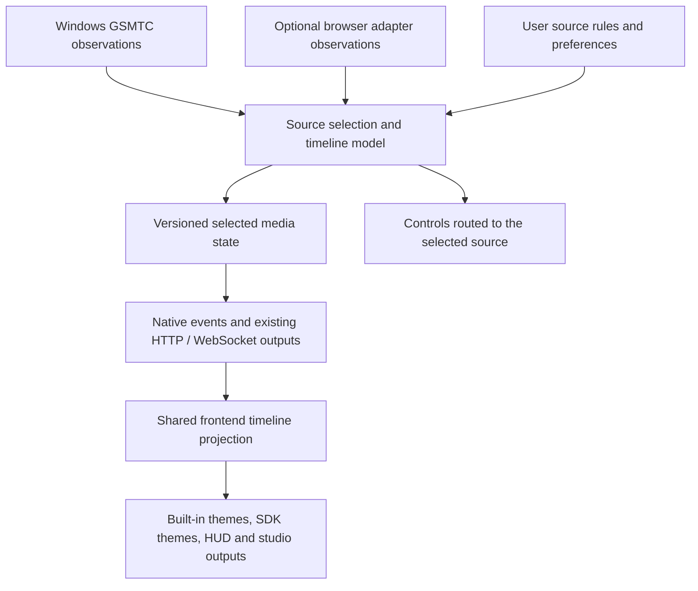

# Browser Media Telemetry and Live Timestamps: Beta Architecture Review

Date: 4 November 2026 (Asia/Riyadh)  
Application: MPO-pro `7.0.0-beta.11`  
Scope: `C:/Users/MD-J/MPO-pro/beta`  
Review basis: the supplied architectural analysis, the current working-tree source, and primary browser/platform documentation. The working tree contains existing uncommitted changes; this report describes those files as inspected, rather than only commit `68aff37`.

**Implementation follow-up, 6 November 2026:** the original review below describes beta 11. Confirmed fixes are implemented for beta 13; see section 9 for changes, validation and remaining uncertainty.

## 1. Verdict

**I agree with the main architectural direction, but I would not adopt the supplied report unchanged.** Repairing the built-in Windows GSMTC timeline pipeline first, then offering an optional browser telemetry bridge, is a sensible fit for Beta. Requiring extensions for basic media display would add setup and maintenance before fixing defects already inside the application.

The code confirms a conditional 30-second backend plateau, missing-duration display restrictions, and inconsistent clock handling between standard and SDK themes. It does **not** establish five independent Brave-specific root causes. Some of the supplied explanations misdescribe the frontend, and the precision, browser coverage, artwork, and maintenance guarantees are too strong.

Recommended decision:

1. Fix and validate the GSMTC timeline model and shared rendering clock.
2. Distinguish unavailable, estimated, live, and measured timeline data.
3. Evaluate an existing WebNowPlaying adapter before committing to a custom extension.
4. Add any bridge as a separate input to a source arbiter, with narrowly scoped access and source-aware controls.

This review creates documentation only. It does not implement these changes or claim that live Brave playback has been reproduced.

## 2. Assessment of the supplied claims

| Claim | Assessment | Correction |
| --- | --- | --- |
| The 30,000 ms clamp can freeze backend timestamps. | Confirmed, conditional. | It plateaus when a playing provider leaves both raw position and timeline timestamp unchanged. This is not specific to Brave. |
| Brave/Chromium only update timelines on play, pause, and seek. | Too categorical. | Provider, site, browser version, and session behavior need observation. Chromium also has a player-derived position fallback. |
| A site must repeatedly call `setPositionState()` or Chromium necessarily reports zero bounds. | Incorrect as a universal rule. | Chromium can derive position from a single underlying media player. Missing bounds remain a case the app must handle. |
| Repeated frozen backend packets force the standard scrubber to freeze at +30 seconds. | Misdescribes the usual code path. | At normal packet intervals, the hook can continue near 0.95x and diverge from the backend instead. |
| Unknown duration stops interpolation and hides timestamps. | Confirmed. | Multiple hook and presentation branches need coordinated changes. Missing duration does not prove that an accurate position exists. |
| SDK/compiled themes bypass the standard interpolation hook. | Confirmed, with narrower scope. | Declarative progress uses snapshots; compiled progress and time labels do too. Many built-in themes already interpolate. |
| Missing Brave normalization causes timeline/session matching failure. | Not demonstrated. | Rust matching uses raw app identifiers before display-name cleanup. Additional names improve labels. |
| Brave Shields/background throttling is an established root cause here. | Unverified hypothesis. | No browser trace or settings evidence was supplied. Audible playback also changes timer-throttling conditions. |
| Extensions provide sub-millisecond or 100% exact timestamps and are immune to background problems. | Unsupported. | Sampling, privacy rounding, buffering, transport delay, and lifecycle behavior still matter. |
| GSMTC artwork is necessarily cropped or low quality. | Unsupported as a blanket claim. | Beta copies the supplied thumbnail bytes; this audit found no resizing in that path. |
| One JSON route provides WebNowPlaying compatibility with no maintenance. | Incorrect. | WebNowPlaying needs its adapter protocol, connection path, handshake, and version handling. |
| All extension origins should be added to the shared trusted-origin list. | Reject this implementation detail. | That list also protects app controls and configuration writes. Telemetry needs a narrower access boundary. |

The evidence and qualifications for these assessments follow.

## 3. Findings confirmed in Beta

### 3.1 The backend has a reproducible 30-second extrapolation ceiling

[`calculate_live_position`](C:/Users/MD-J/MPO-pro/beta/src-tauri/src/media/gsmtc.rs:462) calculates a playing position by adding elapsed wall-clock time since `LastUpdatedTime`, capped at 30,000 ms. With unchanged inputs:

```text
position = raw_position + min(now - last_updated_time, 30,000 ms)
```

A standalone Rust harness compiled and executed the exact function extracted from the current file. With raw position 20,000 ms, duration 180,000 ms, and one unchanged valid timestamp:

| Time since source timestamp | Function output while Playing |
| --- | ---: |
| 0 seconds | 20,000 ms |
| 29 seconds | 49,000 ms |
| 30 seconds | 50,000 ms |
| 31 seconds | 50,000 ms |
| 60 seconds | 50,000 ms |
| 120 seconds | 50,000 ms |

Paused at 60 seconds returns 20,000 ms. Playing with no timestamp also returns the raw 20,000 ms.

**This verifies the failure mechanism, not Brave's actual input sequence.** The missing evidence is a capture showing which raw position, timestamp, status, duration, and rate the affected browser/site publishes during the reported freeze.

The watcher also publishes fresh `updated_at` values for periodic snapshots, even when the underlying timeline is unchanged. See [periodic synchronization](C:/Users/MD-J/MPO-pro/beta/src-tauri/src/media/gsmtc.rs:338) and [snapshot creation](C:/Users/MD-J/MPO-pro/beta/src-tauri/src/media/gsmtc.rs:385). Polling is approximately one second while playing normally and 1.2 seconds in eco mode, plus work time; it is not an exact every-second guarantee.

**Required correction:** replace the ceiling with a validated, stateful timeline anchor. Simply deleting `.min(30_000)` would allow bogus or very old timestamps to produce huge positions or immediately reach the duration bound.

### 3.2 The standard scrubber usually diverges from frozen samples rather than freezing immediately

[`isTimelineSeek`](C:/Users/MD-J/MPO-pro/beta/src/hooks/useScrubber.ts:29) classifies a seek only when the absolute difference between source displacement and elapsed sample time exceeds 2,500 ms.

Executing the exact helper after TypeScript transpilation produced these results for unchanged source position:

| Gap between samples | Classified as a seek? |
| --- | --- |
| 1,000 ms | No |
| 1,200 ms | No |
| 3,000 ms | Yes |

For an ordinary same-track, known-duration Playing update below that threshold, [reconciliation](C:/Users/MD-J/MPO-pro/beta/src/hooks/useScrubber.ts:74) updates the drift target. The [animation loop](C:/Users/MD-J/MPO-pro/beta/src/hooks/useScrubber.ts:103) adjusts speed within roughly 0.95x-1.05x while continuing forward.

Consequently, frozen backend samples arriving every second do not normally pin this hook to the backend's +30-second value. The displayed time can continue slowly and become increasingly inaccurate. A later status/track change, inferred seek, or other reset can then expose a discontinuity. This distinction matters when diagnosing differences between themes.

The current hook also does not render React state at 60 FPS: [normal updates are throttled to about 20 Hz, eco updates to about 5 Hz, and text to integer-second changes](C:/Users/MD-J/MPO-pro/beta/src/hooks/useScrubber.ts:138). RAF scheduling and timestamp accuracy are separate properties.

### 3.3 Unknown duration is treated as a reason to stop or hide timeline output

The restrictions extend beyond the two lines cited in the supplied report:

- [`useScrubber`](C:/Users/MD-J/MPO-pro/beta/src/hooks/useScrubber.ts:70) handles arrival compensation, reconciliation, animation startup, duration clamping, and restart behavior in ways tied to positive duration. Relevant lines are 70, 74, 89, 119, and 187.
- [`Scrubber`](C:/Users/MD-J/MPO-pro/beta/src/components/Scrubber.tsx:12) returns nothing when duration is unavailable.
- [`ThemeSupplement`](C:/Users/MD-J/MPO-pro/beta/src/themes/ThemeSupplement.tsx:12) also requires positive duration before showing the shared timestamps.

Removing just the animation guard would leave other restrictions in place, including a clamp to zero and hidden presentation.

**Required correction:** separate position validity from duration validity. Show elapsed time without a total only when a credible position anchor exists. Otherwise show an unavailable or indeterminate state. Starting a counter when MPO first notices a stream measures time since observation; it does not recover the media's original playhead.

### 3.4 SDK themes do not share the same timeline behavior

[`ThemeRenderer`](C:/Users/MD-J/MPO-pro/beta/src/theme-sdk/ThemeRenderer.tsx:57) derives declarative progress from snapshot `media.position_ms`. Its current declarative element set does not provide a timestamp element, so the supplied claim about its frozen timestamps is broader than the implementation.

[`CompiledThemeRunner`](C:/Users/MD-J/MPO-pro/beta/src/theme-sdk/compiler/CompiledThemeRunner.tsx:133) derives progress and `formattedTime.current` from snapshots and passes raw `media` through to theme code. Updating formatted text alone would leave custom themes that read `media.position_ms` inconsistent.

Many built-in themes already use `useScrubber`; [BigStage](C:/Users/MD-J/MPO-pro/beta/src/big-studio/BigStage.tsx:36) does as well. Adding independent animation loops at every rendering layer can duplicate work and produce different reconciliation behavior.

**Required correction:** provide one shared timeline projection per selected source in each frontend window, with a defined SDK contract for projected time versus raw observations. Consume that projection across built-in, declarative, compiled, Big Studio, HUD, and browser-output surfaces.

### 3.5 Browser naming is a secondary cleanup

[`clean_app_name`](C:/Users/MD-J/MPO-pro/beta/src-tauri/src/media/gsmtc.rs:433) lacks explicit Brave, Opera, Vivaldi, and Zen branches. However, [session selection](C:/Users/MD-J/MPO-pro/beta/src-tauri/src/media/gsmtc.rs:134) and filtering use raw `SourceAppUserModelId` values before cleanup. The frontend already has [rules for these browsers](C:/Users/MD-J/MPO-pro/beta/src/utils/appSources.ts:137).

Adding display names is reasonable. It does not repair the clock or recover a browser identity from an opaque identifier that contains no recognizable browser name. Broad substring matching such as `zen` also needs care to avoid unrelated identifiers.

### 3.6 Important gaps omitted from the original root-cause list

**Playback rate:** [playback extraction](C:/Users/MD-J/MPO-pro/beta/src-tauri/src/media/gsmtc.rs:279) reads status but not rate. Neither [Rust MediaState](C:/Users/MD-J/MPO-pro/beta/src-tauri/src/media/types.rs:4) nor [TypeScript MediaState](C:/Users/MD-J/MPO-pro/beta/src/types/media.ts:5) carries playback rate. The clock and seek detector effectively assume 1x. Windows exposes a nullable playback-rate property, so GSMTC rate support should be attempted before assuming an extension is the only solution. [Microsoft API documentation](https://learn.microsoft.com/en-us/uwp/api/windows.media.control.globalsystemmediatransportcontrolssessionplaybackinfo.playbackrate?view=winrt-26100).

**Source identity:** [backend track-change detection](C:/Users/MD-J/MPO-pro/beta/src-tauri/src/media/gsmtc.rs:321) compares title and artist. Actual selected-session changes are not an explicit publication trigger. Two sources with identical metadata must still receive separate anchors and ownership.

**Unknown data:** [timeline extraction](C:/Users/MD-J/MPO-pro/beta/src-tauri/src/media/gsmtc.rs:296) turns errors into zero values and does not preserve start/seek bounds. Consumers cannot reliably distinguish an absent timeline from a real zero position, or finite media from a moving live window.

**Ordering:** [`useMediaState`](C:/Users/MD-J/MPO-pro/beta/src/hooks/useMediaState.ts:46) accepts updates from HTTP, WebSocket, and native events. The scrubber has a local check for older same-track timestamps, but that does not establish shared ordering for SDK consumers. Source generation and sequence numbers would provide a stronger boundary than publication wall time alone.

## 4. Browser/platform claims that need qualification

### Chromium is not entirely dependent on site-authored position state

Microsoft defines timeline `Position` as current at `LastUpdatedTime`, supporting extrapolation from an observation. It does not guarantee a specific provider update interval. [Microsoft timeline documentation](https://learn.microsoft.com/en-us/uwp/api/windows.media.control.globalsystemmediatransportcontrolssessiontimelineproperties?view=winrt-26100).

Chromium's media-session implementation prefers explicit position state but can fall back to the underlying player when a single normal player is present. Therefore, “no `setPositionState()` means zero duration/position” is not a valid universal diagnosis. This source review also does not establish the behavior of a particular installed Brave build. [Chromium `RebuildAndNotifyMediaPositionChanged` implementation](https://raw.githubusercontent.com/chromium/chromium/main/content/browser/media/session/media_session_impl.cc).

### Direct browser access improves observability, not guaranteed accuracy

HTML media duration can be unknown (`NaN`) or unbounded (`Infinity`). The standard's periodic `timeupdate` processing is on the order of 15-250 ms, subject to its scheduling conditions; it does not promise sub-millisecond event delivery. Transport and rendering add further delay. [HTML media specification](https://html.spec.whatwg.org/multipage/media.html).

Firefox can also round `currentTime` for privacy, including coarser precision under fingerprinting protection. A floating-point API value does not guarantee corresponding measurement precision. [Mozilla documentation on reduced time precision](https://developer.mozilla.org/en-US/docs/Web/API/HTMLMediaElement/currentTime#reduced_time_precision).

Use claims such as “direct media-element observations with local interpolation,” and measure error on supported configurations. Do not advertise “100% exact,” “10 ms guaranteed,” or “sub-millisecond.”

### Background behavior and extension lifecycle still require recovery

Chromium's documented intensive timer throttling has conditions including hidden duration and recent silence; recently audible pages receive different treatment. This does not prove the behavior of every Brave build, but it contradicts a blanket assumption that background music timers always run once per minute. [Chrome timer-throttling explanation](https://developer.chrome.com/blog/timer-throttling-in-chrome-88).

Chrome normally terminates idle extension workers after 30 seconds. Starting in Chrome 116, WebSocket message activity resets that idle timer; the documented five-minute limit concerns a single long-running request, not a universal “five minutes of WebSocket idle” rule. Design restart, reconnect, and full-snapshot recovery regardless. [Chrome worker lifecycle](https://developer.chrome.com/docs/extensions/develop/concepts/service-workers/lifecycle).

### A background connection is sensible, but permissions remain explicit

Content-script-to-background messaging is a reasonable boundary. Chrome documents cross-origin requests from extension contexts with appropriate host permissions, while content-script requests retain page-origin restrictions. Extension CSP can also constrain connections. This does not establish a universal bypass of every Brave or local-network restriction. [Chrome extension network requests](https://developer.chrome.com/docs/extensions/develop/concepts/network-requests).

Local/loopback access policy is browser-version dependent and has evolved beyond the supplied report's PNA-only description. Test the supported builds and avoid asking users to disable protections as the default solution. [Chrome Local Network Access guidance](https://developer.chrome.com/docs/modern-web-guidance/guides/security/local-network-access).

Cross-browser code sharing is realistic, but the “98%” figure is unmeasured. Firefox and Chromium have different background implementations and distribution requirements. [Mozilla background manifest documentation](https://developer.mozilla.org/en-US/docs/Mozilla/Add-ons/WebExtensions/manifest.json/background).

### Artwork and filtering are opportunities, not guarantees

Beta's [thumbnail extraction](C:/Users/MD-J/MPO-pro/beta/src-tauri/src/media/gsmtc.rs:415) copies Windows-provided bytes, and [`/api/art`](C:/Users/MD-J/MPO-pro/beta/src-tauri/src/server/router.rs:234) serves those bytes. Neither proves that Windows always resizes or crops the original.

A bridge may supply better artwork and site-specific metadata. Availability depends on the site and access permissions. Filtering muted or short media is only a heuristic: it can discard legitimate selections. Ad classification also needs site-specific behavior and ongoing maintenance.

## 5. Recommended architecture



### 5.1 Establish a reliable timeline contract

Keep provider observations separate from projected playback time. Suggested additions, introduced compatibly:

| Information | Purpose |
| --- | --- |
| Provider, stable source/session key, track generation | Prevent mixing anchors and metadata between sources. |
| Sequence number and source observation time | Order real observations and reject old state. |
| Backend receive time and publication time | Distinguish transport freshness from media freshness. |
| Position validity and origin: observed, estimated, unavailable | Avoid presenting fabricated exact playheads. |
| Known/unknown duration and live/seekable bounds | Support finite media, live windows, and missing timelines independently. |
| Playback rate and availability | Project at the actual rate when supplied; mark assumptions otherwise. |
| Playing, paused, ended, and buffering/stalled evidence where available | Avoid treating a connected or nominally Playing source as guaranteed advancement. |
| Control capabilities and artwork ownership/version | Keep actions and artwork attached to the selected source. |

Monotonic timestamps from separate processes cannot be compared directly. Use backend receipt time and a defined protocol for any source-clock mapping. Keep UTC timestamps for interoperability and diagnostics, rather than using wall-clock differences as the sole ongoing clock.

### 5.2 Replace the stateless cap with an anchor state machine

For a trustworthy anchor and advancing playback:

```text
estimated_position = anchor_position + playback_rate * monotonic_elapsed
```

The implementation should:

1. Validate timestamp conversion, position bounds, and initial timeline credibility. A credible old timestamp may be useful; an invalid epoch must not become unlimited elapsed playback.
2. Seed the initial anchor from the best credible observation. Anchoring a stale raw position to “now” discards playback that has already elapsed.
3. Preserve the anchor while a source keeps returning an unchanged observation. Polling the same tuple is not a new position measurement.
4. Freeze the current estimate on pause when the source data is stale, then resume from the frozen value. Accept fresh authoritative pause/seek data when available.
5. Reconcile actual timeline updates and reset appropriately on session, track, seek, rate, or discontinuity changes. A changed timestamp alone is not automatically a trustworthy new anchor.
6. Clamp finite media to validated bounds; treat live windows separately. Never invent a total duration.
7. Reconcile after suspend/resume, source loss, or reconnection. If the source cannot reveal buffering or hidden seeks, retain that uncertainty rather than promising perfect synchronization.

Progress should remain forward between authoritative corrections. Deliberate backward seeks and source changes must still be allowed to move the displayed position backward.

### 5.3 Give every renderer the same clock semantics

Use the shared projection for progress and formatted time across surfaces. Decide explicitly whether compiled themes receive projected `media.position_ms` or a separate clock property; document and test that contract. Preserve access to raw observations for diagnostics.

Maintain second-based text updates and appropriate eco throttling. A 60 Hz backend feed or full React rerender is not required for smooth presentation. Choose higher visual progress rates only where they provide a measured benefit.

## 6. Optional bridge: implementation choices and constraints

### Existing WebNowPlaying integration

**Recommended first experiment:** a small compatibility prototype using the current WebNowPlaying adapter interface. It can reduce ownership of site parsers and extension distribution, while leaving Beta responsible for integration, compatibility, packaging, arbitration, and recovery.

The official documentation describes a C adapter library, currently lists no language bindings, and supports custom adapters through extension settings. A listed adapter has additional release and port requirements. [WebNowPlaying adapter guide](https://wnp.keifufu.dev/creating-adapters/getting-started).

The current extension socket implementation connects to the adapter's loopback port at the root WebSocket path, expects an adapter/version handshake, and supports protocol revisions including binary artwork. Adding a JSON POST route or reusing Beta's `/ws` unchanged is therefore not sufficient. A separate adapter listener/port is a practical prototype boundary; verify the chosen library revision before implementation. [Official WebNowPlaying socket implementation](https://github.com/keifufu/WebNowPlaying/blob/main/src/extension/sw/socket.ts).

Generic site support is not guaranteed even by WebNowPlaying's own documentation. [Extension settings](https://wnp.keifufu.dev/extension/settings).

### Custom extension or userscript

A custom extension offers control over selection, payloads, pairing, and product integration, at the cost of browser testing, store releases, permissions, and site maintenance. A userscript may help prototype one supported site, but still requires installation and manager-specific behavior.

Direct element observation needs media events, player replacement handling, frame permissions, and buffering/seek/rate handling. A document-level listener does not automatically solve cross-origin frames, inaccessible player internals, or every playback technology. Prefer a defined supported-site matrix over an “all browsers/all sites” guarantee.

CDP/remote debugging is useful for development diagnostics. Its setup and browser-specific coverage make it a poor default end-user dependency for this application.

### Preserve a narrow ingress boundary

Beta currently binds to [IPv4 loopback](C:/Users/MD-J/MPO-pro/beta/src-tauri/src/server/router.rs:146). Its [routes](C:/Users/MD-J/MPO-pro/beta/src-tauri/src/server/router.rs:124) expose state, artwork, controls, configuration, and an outbound socket. The [socket receiver](C:/Users/MD-J/MPO-pro/beta/src-tauri/src/server/router.rs:344) consumes frames but only acts on Close; it does not ingest browser media.

For a custom bridge, add a dedicated telemetry route or listener with a paired capability/token and narrowly defined origin handling. Do not add every extension origin to the existing global [trusted-origin gate](C:/Users/MD-J/MPO-pro/beta/src-tauri/src/server/router.rs:164): that would also authorize unrelated extensions for writable app endpoints. Origin checks and CORS are not a substitute for authenticating a telemetry producer.

Bound payload sizes, strings, update rates, connection counts, and artwork data. If the backend fetches artwork URLs, validate schemes, destinations, and redirects instead of providing an unrestricted URL fetcher. These are design requirements for the proposed input, not claims that the current read-only media socket already accepts such payloads. Third-party adapter security constraints should be evaluated explicitly rather than assuming its protocol supports custom pairing.

### Arbitration and controls must follow source ownership

A heartbeat within three seconds proves a connection is alive; it does not identify the correct tab or prove that its playhead is fresh. Keep GSMTC and bridge observations independently, then select with user source rules, identity, activity, freshness, and stable handoff behavior. A paused bridge tab must not continuously replace another active player.

Where a GSMTC browser session cannot be confidently correlated to a bridge player, use an explicit selection policy instead of silently merging metadata from one source and position from another. Bridge disconnection should restore a suitable current GSMTC source without resurrecting an old track.

Existing [media controls](C:/Users/MD-J/MPO-pro/beta/src-tauri/src/media/gsmtc.rs:78) independently select a GSMTC session. Once a bridge player is selected, controls must target that player or clearly expose unavailable capabilities; otherwise the overlay can display one tab while controlling another.

## 7. Prioritized delivery plan

| Priority | Work | Completion evidence |
| --- | --- | --- |
| P0 | Capture the affected Brave session's raw timeline and status; implement validated source anchors and rate handling. | Controlled long-running timeline cases pass; captured browser playback no longer plateaus from the app's 30-second ceiling. |
| P0 | Unify projected time across built-in and SDK rendering paths. | Progress and labels agree for the same selected state across representative surfaces. |
| P1 | Model unknown position/duration/live bounds; update all associated presentation guards. | Meaningful elapsed time works without duration; unavailable data is not represented as an exact counter. |
| P1 | Add stable source identity, ordering, and recovery behavior. | Same-title source switches, duplicate transports, delayed samples, and reconnections preserve correct ownership. |
| P2 | Prototype WebNowPlaying interoperability and evaluate packaging/security constraints. | A pinned protocol revision works end to end with supported browser/site combinations. |
| P2 | If justified, implement a custom bridge with scoped ingress and source-aware controls. | Pairing, validation, selection, control routing, and fallback pass integration tests. |
| P3 | Improve fallback browser display names. | Labels improve without changing filtering semantics or introducing broad false matches. |

The supplied “90% solved,” “flawless,” and exact-precision estimates are not supported by measurements. Set quality targets after collecting a representative browser/site baseline.

## 8. Validation and remaining uncertainty

### Checks performed for this review

- Read the relevant Rust watcher, state types, thumbnail path, server routes, frontend state ingestion, scrubber, renderer, and source-rule code.
- Compiled and executed the exact extracted Rust position helper with `rustc 1.95.0`, confirming the controlled 30-second plateau and paused/missing-timestamp outputs. Temporary harness files were removed.
- Executed the extracted TypeScript seek helper after transpilation, confirming the sample-gap classifications reported above.
- Checked the platform and extension claims against the primary documentation and implementations linked beside those claims.

These are focused function checks and a source review. They do not exercise Windows COM, actual browser output, React animation lifecycle, OBS, or a working bridge. No full application build or full test suite was run for this documentation-only task.

### Tests needed before implementation can be called complete

| Scenario | Required behavior |
| --- | --- |
| Two to five minutes with unchanged raw timeline | No artificial 30-second plateau; uncertainty remains explicit. |
| Missing, future, zero, or invalid timeline timestamp | No overflow, huge jump, or false exact position. |
| Unknown duration with and without a credible position | Elapsed-only display when justified; indeterminate display otherwise. |
| Pause/resume while raw timeline stays unchanged | No counting through the paused interval or reset to an obsolete raw anchor. |
| Forward and backward seeks | Timely authoritative correction; no monotonic rule blocking a deliberate rewind. |
| 0.5x, 1x, 1.5x, and 2x playback | Rate-aware projection and seek classification. |
| Buffering, ended media, and live/DVR windows | No unqualified advancement beyond meaningful bounds. |
| Session switch with identical title/artist | New source ownership, artwork, controls, and anchor. |
| Duplicate/out-of-order HTTP, native, and WebSocket state | No stale overwrite of the selected generation. |
| Minimized/background output, eco mode, and system suspend | Correct reconciliation on recovery; controlled rendering cost. |
| Multiple bridge tabs/profiles and bridge loss | Stable selection, suitable fallback, and source-correct controls. |
| Invalid producers and oversized telemetry/artwork | Ingress rejects invalid data without broadening configuration access. |

Run that matrix on recorded versions of Brave, Chrome, Edge, and Firefox, with finite HTML5 media, representative supported music/video sites, live media, and a desktop player as a control.

Existing [Rust timeline tests](C:/Users/MD-J/MPO-pro/beta/src-tauri/src/media/gsmtc.rs:497) cover basic advancement, pause, and duration bounds. The [theme parity tests](C:/Users/MD-J/MPO-pro/beta/scripts/test-theme-parity.cjs:40) cover seek classification, but do not prove the integration cases above.

One separate pre-existing check also needs attention before relying on the security suite: [router security tests](C:/Users/MD-J/MPO-pro/beta/src-tauri/src/server/router.rs:369) first accept a `POST /api/layers` from `http://localhost:4849`, then reject the identical request at line 374 without changing its inputs. Those assertions are contradictory. This is a test defect found by inspection, not a demonstrated timestamp cause.

**Acceptance position:** approve the hybrid direction with the corrections above. Treat the code defects as actionable now, the Brave-specific explanation as a hypothesis to verify, and the optional bridge as a separately scoped integration project.

## 9. Beta 13 implementation follow-up

Implemented for `7.0.0-beta.13` on 6 November 2026:

- Replaced `calculate_live_position` with a stateful monotonic `TimelineClock`. Unchanged provider tuples retain their anchor across periodic publications, with no 30-second projection ceiling. Initial UTC compensation is validated and bounded; invalid/epoch/future/stale timestamps cannot create huge jumps. Timestamp-only refreshes do not automatically reanchor a running clock. Fresh position/bounds and status/rate transitions can correct it.
- Stale pause data freezes the current estimate, resume excludes the paused interval, and authoritative forward/backward seeks remain possible. Nullable GSMTC playback rates are carried with a known/assumed flag; validated nonnegative rates through 16x, including zero, are supported. `Changing` status is surfaced as buffering evidence. Hidden buffering remains unobservable if the provider only reports Playing.
- Published independent position/duration validity, observed/estimated/unavailable origin, uncertainty, normalized bounds, original source start, and the raw provider tuple. Moving DVR-window evidence is distinguished from finite duration and unknown duration; missing duration alone never establishes LIVE. Long watcher gaps freeze stale estimates until fresh evidence corrects them.
- Added selected-session identity, source/track/loss generations, process stream IDs and publication sequences. Source selection still filters raw app IDs. Controls retain and target the selected COM session rather than selecting a potentially different session again. Artwork and anchors reset on same-title source changes.
- HTTP snapshots, native events and WebSocket publications pass one ordering gate before metadata, artwork or clock updates. Duplicates, retired generations/processes and delayed initial snapshots cannot overwrite newer state. Empty startup snapshots also have process/sequence identity for reconnect recovery.
- Replaced per-theme interpolation loops with one shared clock per frontend window. Subscriptions stay in renderers, with about 20 Hz progress updates or 5 Hz in eco/background mode, avoiding a whole-dashboard clock rerender. SDK `media.position_ms`, `progress` and `formattedTime` use the projection; `rawMedia` preserves the backend publication. Projected time is never extrapolated twice. A frontend without backend publications stops estimating after a 15-second freshness window; this is distinct from a provider tuple that remains unchanged while the backend continues publishing.
- Updated all native theme families, shared scrubbers/supplements, declarative/compiled SDK rendering and Big Studio for elapsed-only and unavailable timeline presentation. Starter themes, Builder source exports, portable authoring types and the in-app SDK/LLM document describe the same contract.
- Added bounded in-memory diagnostic capture (900 recent transport observations), including accepted/rejected ordering decisions, source identity, raw timeline, receipt time, publication time, rate and uncertainty. **Diagnostics → Copy media telemetry** exports it locally to the clipboard. Synthetic diagnostics now exercise the actual shared clock model and do not claim to measure browser accuracy.
- Added conservative Brave, Opera, Vivaldi and Zen display names without changing raw source filtering. Corrected the contradictory router-origin test using an actually untrusted port; runtime origin permissions remain unchanged.

Validation performed:

- Rust tests cover five minutes of unchanged observations, missing/invalid/future/old timestamps, credible initial compensation, independent unknown data, stale and fresh pause/resume, forward/backward seeks, 0.5x/1x/1.5x/2x/4x and zero/invalid rates, finite bounds, buffering, moving DVR windows, source generations, wall-clock changes and long-gap recovery.
- `npm run test:media` covers the shared frontend model, transport compensation, five-minute publication sequences, duplicate/out-of-order/restarted transports, source ownership, finite bounds, unknown data and representative native/declarative/compiled/Big rendering paths. Existing theme/SDK/Arrange/effect and popover suites pass.
- A live local browser fixture displayed identical millisecond projections in built-in, compiled SDK, declarative SDK and Big Studio consumers. It verified pause freeze, resume, backward seek, 2x rate, elapsed-only output, unavailable `--:--`, and indeterminate rails without exact percentages. No browser console errors were observed. The temporary fixture was removed.
- TypeScript/Vite compilation and the full Tauri Windows x64 NSIS installer build pass for `7.0.0-beta.13`. All 14 non-registry Rust tests pass. The pre-existing autostart integration test requires access to write Windows startup registry settings and failed under the restricted test environment; it is excluded from the non-mutating suite.

Remaining scope and uncertainty: an affected Brave/site raw trace has not yet been captured, and the browser/site/OBS/native playback matrix in section 8 is not represented as completed. The implementation removes the confirmed application defects; it does not establish a specific browser root cause or exact provider accuracy. Use the new raw capture on affected sessions for that evidence. WebNowPlaying interoperability, extension ingress, multi-tab arbitration and bridge-specific controls/security remain the separately scoped optional integration described in section 6; no extension origins or telemetry ingress were added to shared configuration/control routes.
